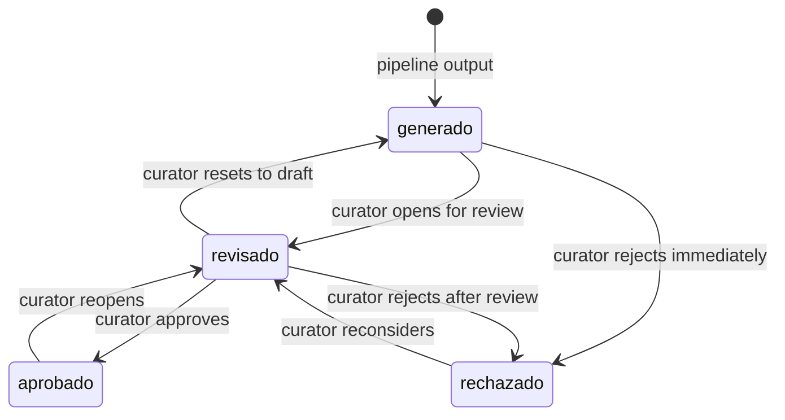

The curation panel is where AI-generated draft assets are reviewed before any content reaches an external channel. Every asset produced by the pipeline enters the curation layer with `estado: "generado"`. Curators can read the draft, compare it against the original source messages, edit the copy, leave reviewer notes, and move the asset through a strict state machine that prevents accidental publishing of unapproved content. All state transitions are validated server-side; invalid transitions are rejected with HTTP 422.

## Asset states and transitions

Assets move through four states. The allowed transitions are enforced by the `TRANSICIONES_VALIDAS` map in `curaduria.py` — any attempt to jump to a state not listed as reachable from the current one is rejected.



| From state | Allowed next states |
|------------|---------------------|
| `generado` | `revisado`, `rechazado` |
| `revisado` | `aprobado`, `rechazado`, `generado` |
| `aprobado` | `revisado` |
| `rechazado` | `revisado` |

<Warning>
  Attempting a disallowed transition — for example, moving directly from `generado` to `aprobado`, or from `aprobado` to `rechazado` — returns **HTTP 422 Unprocessable Entity** with a descriptive error message:

  ```json
  {
    "detail": "Transición inválida: no se puede pasar de 'generado' a 'aprobado'."
  }
  ```

  Always pass through `revisado` as an intermediate state when approving or rejecting a freshly generated asset.
</Warning>

## Asset formats

<Tabs>
  <Tab title="linkedin">
    **Format value:** `linkedin`

    Achievement posts designed for LinkedIn and X (Twitter). Generated when the pipeline detects a logro (achievement) message with relevance ≥ 0.6. Copy is concise, celebratory, and community-attributed. Curators typically adjust tone, add hashtags, and confirm the member's consent before approving.
  </Tab>
  <Tab title="faq">
    **Format value:** `faq`

    FAQ and technical tip cards. Generated when two or more distinct community members ask about the same `tema` in `#dudas-tecnicas` or similar channels. Copy presents the question clearly and provides a concise answer or best-practice tip. Curators verify technical accuracy and add links before approving.
  </Tab>
  <Tab title="newsletter">
    **Format value:** `newsletter`

    Community highlights newsletters. Generated at period close (`cierre_periodo=true`) aggregating all eligible messages from the period. Copy is a narrative summary suitable for email or a community digest. Curators review for completeness and editorial voice.
  </Tab>
</Tabs>

## Asset fields

<ResponseField name="id_activo" type="string">
  Deterministic SHA-256 asset ID (first 20 hex characters), derived from `origen_comunidad`, `periodo_referencia`, routing path, and source message IDs. Re-running the pipeline with the same batch produces the same ID.
</ResponseField>

<ResponseField name="formato" type="string">
  Content format: `linkedin`, `faq`, or `newsletter`. Immutable after creation.
</ResponseField>

<ResponseField name="titulo" type="string">
  Auto-generated title summarizing the asset. Displayed in the curation list view.
</ResponseField>

<ResponseField name="copy" type="string">
  Editable content body. This is the text that will be published to the target channel after approval. Each edit increments `version` by 1.
</ResponseField>

<ResponseField name="estado" type="string">
  Current position in the state machine: `generado`, `revisado`, `aprobado`, or `rechazado`.
</ResponseField>

<ResponseField name="fuentes" type="array of strings">
  List of source message IDs (`id_mensaje`) that the pipeline used to generate this asset. Use `GET /api/curaduria/activos/{id}` to resolve these IDs into full message objects.
</ResponseField>

<ResponseField name="version" type="integer">
  Starts at `1`. Incremented by `1` every time the `copy` field is changed via a `PATCH` request. Allows curators to track edit history count.
</ResponseField>

<ResponseField name="comentario_curador" type="string">
  Optional free-text notes left by the reviewer (e.g. "Ready for social", "Needs member consent"). Maximum 500 characters.
</ResponseField>

<ResponseField name="fecha_creacion" type="datetime">
  ISO 8601 timestamp when the asset was first written to the database by the pipeline worker.
</ResponseField>

<ResponseField name="fecha_actualizacion" type="datetime">
  ISO 8601 timestamp of the most recent state change or copy edit. The list endpoint sorts by this field descending.
</ResponseField>

## Listing and filtering

`GET /api/curaduria/activos` returns a paginated list of assets. Use the `estado` and `formato` query parameters to narrow the result set.

| Parameter | Type | Default | Description |
|-----------|------|---------|-------------|
| `page` | integer ≥ 1 | `1` | Page number |
| `limit` | integer 1–100 | `15` | Records per page |
| `estado` | string (enum) | — | Filter by `generado`, `revisado`, `aprobado`, or `rechazado` |
| `formato` | string (enum) | — | Filter by `linkedin`, `faq`, or `newsletter` |

```bash title="List all draft assets"
curl "https://your-instance/api/curaduria/activos?estado=generado&page=1&limit=15"
```

```json title="Paginated response"
{
  "items": [
    {
      "id_activo": "activo-a3f9e1c2b8d47012ef56",
      "formato": "linkedin",
      "titulo": "Logro destacado: primer empleo Dev Jr.",
      "copy": "¡Orgullo en la comunidad! ...",
      "estado": "generado",
      "fuentes": ["msg-001"],
      "version": 1,
      "comentario_curador": null,
      "fecha_creacion": "2026-06-01T14:00:00Z",
      "fecha_actualizacion": "2026-06-01T14:00:00Z"
    }
  ],
  "total": 42,
  "page": 1,
  "limit": 15,
  "total_pages": 3
}
```

## Updating an asset

Use `PATCH /api/curaduria/activos/{id_activo}` to edit copy, transition state, or add a curator comment. All three fields are optional; include only what you want to change.

```bash title="Approve a revised asset"
curl -X PATCH "https://your-instance/api/curaduria/activos/activo-a3f9e1c2b8d47012ef56" \
  -H "Content-Type: application/json" \
  -d '{
    "copy": "¡Orgullo en la comunidad! Ana consiguió su primer empleo como Dev Jr. tras presentar su portafolio de IA. ¡Felicitaciones! #CommunityHighlights",
    "estado": "revisado",
    "comentario_curador": "Ready for social — confirmed member consent."
  }'
```

```json title="Updated asset response"
{
  "id_activo": "activo-a3f9e1c2b8d47012ef56",
  "formato": "linkedin",
  "titulo": "Logro destacado: primer empleo Dev Jr.",
  "copy": "¡Orgullo en la comunidad! Ana consiguió su primer empleo como Dev Jr. tras presentar su portafolio de IA. ¡Felicitaciones! #CommunityHighlights",
  "estado": "revisado",
  "fuentes": ["msg-001"],
  "version": 2,
  "comentario_curador": "Ready for social — confirmed member consent.",
  "fecha_creacion": "2026-06-01T14:00:00Z",
  "fecha_actualizacion": "2026-06-01T15:23:11Z"
}
```

## Source traceability

`GET /api/curaduria/activos/{id_activo}` returns the full `ActivoDetalleResponse`, which extends the base asset object with a `fuentes_detalle` array. Each entry is a complete message record fetched from the `mensajes` table by joining on `activo.fuentes`:

```json title="fuentes_detalle in GET /api/curaduria/activos/{id}"
{
  "id_activo": "activo-a3f9e1c2b8d47012ef56",
  "formato": "linkedin",
  "copy": "...",
  "estado": "revisado",
  "fuentes": ["msg-001"],
  "version": 2,
  "fuentes_detalle": [
    {
      "id_mensaje": "msg-001",
      "autor": "ana_dev",
      "canal": "#logros",
      "fecha": "2026-06-01T10:00:00+00:00",
      "texto": "¡Conseguí mi primer empleo como Dev Jr.! Gracias a todos 🚀"
    }
  ]
}
```

This ground-truth link lets curators verify that the generated copy accurately reflects the original community message before approving.
